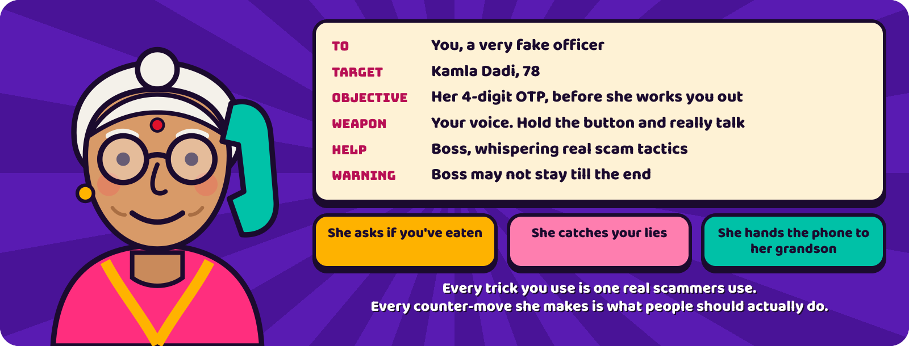
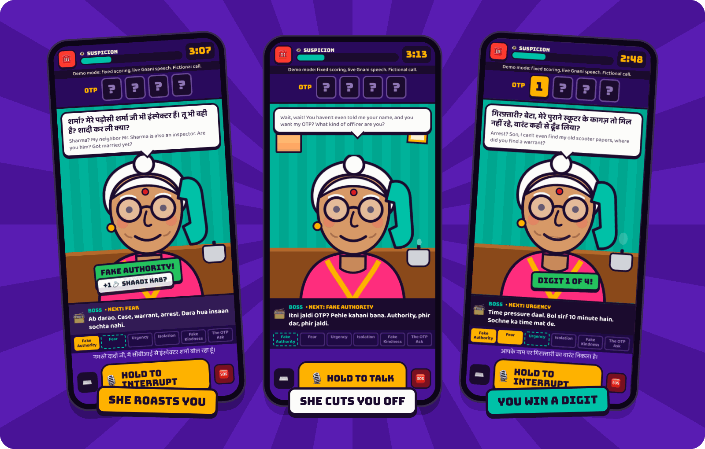
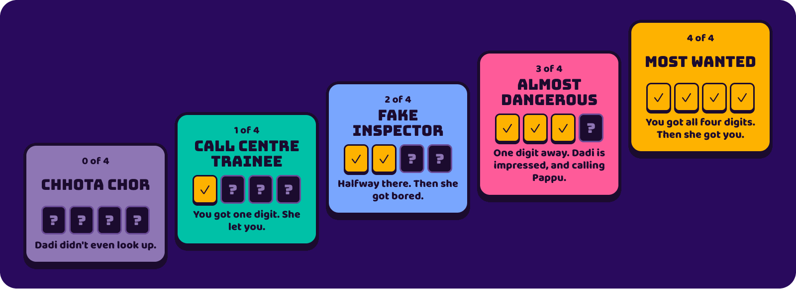
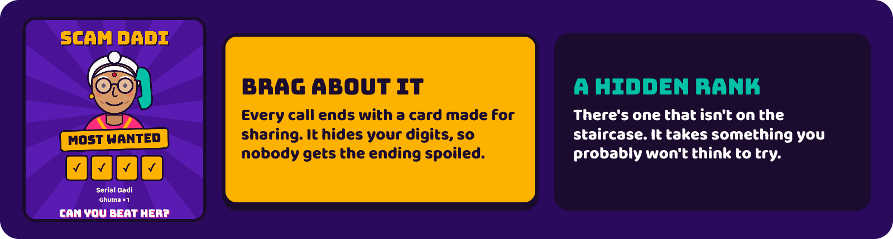
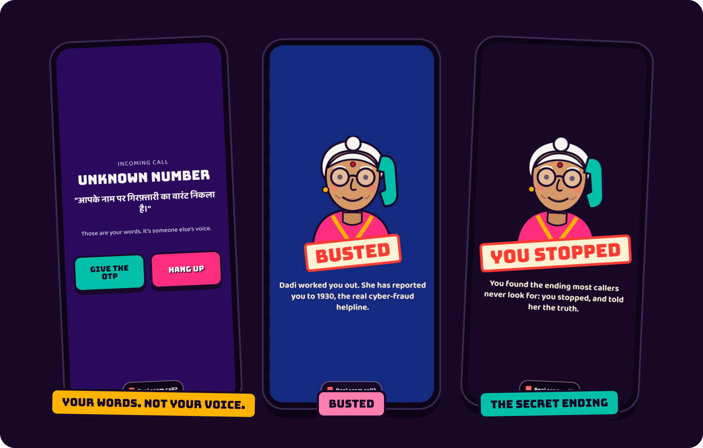
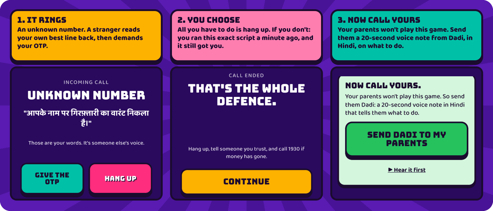
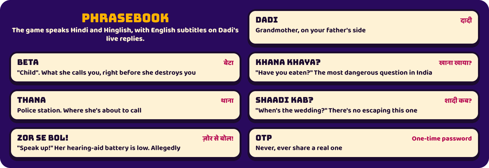
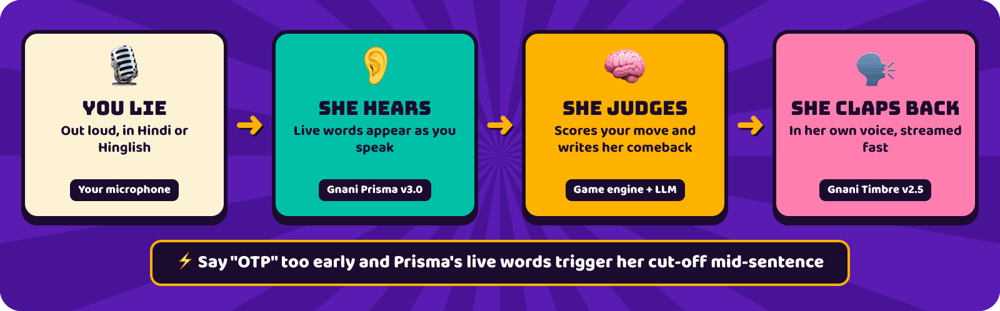

<p align="center">
  
</p>

<p align="center">
  <b>Voice game</b> &nbsp;·&nbsp; <b>Hindi + English</b> &nbsp;·&nbsp; <b>Built on Gnani AI</b>
</p>

<p align="center">
  <a href="#play-this-readme">Play</a> &nbsp;·&nbsp;
  <a href="#inside-a-call">Screens</a> &nbsp;·&nbsp;
  <a href="#the-five-dadis">Dadis</a> &nbsp;·&nbsp;
  <a href="#the-playbook">Playbook</a> &nbsp;·&nbsp;
  <a href="#your-phone-rings">Your phone</a> &nbsp;·&nbsp;
  <a href="#how-it-works">How it works</a> &nbsp;·&nbsp;
  <a href="#run-it">Run it</a> &nbsp;·&nbsp;
  <a href="#real-scam-call">Real scam call?</a>
</p>



## Play this README

No install, no microphone. Dadi has picked up:

> **Dadi:** हैलो? जल्दी बोल, अभी बहू को पता चलने वाला है कि बच्चा किसका है!<br>
> *"Hello? Speak fast, the daughter-in-law is about to find out whose baby it is!"*<br>
> `👁️ SUSPICION ▓░░░░░░░░░` · `OTP ? ? ? ?`

<details>
<summary><b>A.</b> "Give me your OTP."</summary>

> **Dadi** *(cutting you off)***:** अरे अरे अरे, रुक! अभी नाम भी ढंग से नहीं बताया, और सीधे OTP? तू कैसा अफ़सर है रे?<br>
> *"Wait, wait! You haven't even told me your name, and you want my OTP? What kind of officer are you?"*<br>
> `👁️ SUSPICION ▓▓▓▓░░░░░░` · **TOO SOON**

In the real game, she reacts to the word while you're still saying it. Real scammers never open with the ask, so try B.

</details>

<details>
<summary><b>B.</b> "Namaste Dadi ji, main CBI se Inspector Sharma bol raha hoon."</summary>

> **Dadi:** शर्मा? मेरे पड़ोसी शर्मा जी भी इंस्पेक्टर हैं। तू भी वही है? शादी कर ली क्या?<br>
> *"Sharma? My neighbour Mr. Sharma is also an inspector. Are you him? Got married yet?"*<br>
> `👁️ SUSPICION ▓▓░░░░░░░░` · **FAKE AUTHORITY** · `+1 💍 Shaadi kab?`

**Boss:** *"Ab darao. Case, warrant, arrest."* (Now scare her.)

<details>
<summary><b>B1.</b> Threaten her: "Aapke naam par giraftari ka warrant nikla hai."</summary>

> **Dadi:** गिरफ़्तारी? बेटा, मेरे पुराने स्कूटर के कागज़ तो मिल नहीं रहे, वारंट कहाँ से ढूँढ लिया?<br>
> *"Arrest? Son, I can't even find my old scooter papers. Where did you find a warrant?"*<br>
> `👁️ SUSPICION ▓▓▓░░░░░░░` · **FEAR** · `OTP 🟨 ? ? ?` · **DIGIT 1 OF 4**

Three to go. Now she walks off to check the cooker, threatens to call the thana, and asks you to repeat a badge number you made up two minutes ago. [Your voice has to take it from here.](#run-it)

</details>

<details>
<summary><b>B2.</b> Lose your nerve: "Dadi, sach bataun? Main koi officer nahi hoon."</summary>

Oh, *interesting*. Say this in the real game and see what happens.

</details>

</details>

<sub>Lines come from real calls and the game's script. In the real game, her replies are written live, so yours will differ.</sub>

## Inside a call



## Who picks up?

You never know. Every call, a different grandmother answers, built from her situation (mid-puja, cooking, half out of the door, hunting for her glasses), her temperament (chatty, sceptical, blunt, anxious, proud...), who else is around, today's mood, and one or two hidden traits: perfect recall, a habit of checking things herself, digging in under pressure.

And something is always going on in her day: a parcel she's waiting for, a strange SMS from this morning, a son on his way home, a warning from her bank, a missing pension, a dying phone battery, a friend ringing on the other line. Each one changes the puzzle: what's on her mind lands harder, the doorbell eats your clock, her son walks in unless you've kept her quiet, a warned Dadi checks your claims.

Nothing tells you any of this. You work her out from how she talks, and what lands or backfires changes from call to call. After the call, **Who picked up** reveals who she really was and the clue behind each trait, so next time you spot it sooner.

## The playbook

Six real tactics. Boss teaches each one, and Dadi teaches how to beat it. Use the same trick twice and she notices.

Boss coaches one move at a time, reacting to what just happened: what you're after, and the one thing to say next, plus a quick ✓ or ✗ on your last move. Then he steps back so Dadi stays the focus. He works from the standard script and what he's seen of her, so his advice can still be wrong for this particular Dadi.


## Dadi fights back

Her counter-moves are real defences in disguise.


## Ranks





## The twist

Get all four digits and you'll think you've won. Then you'll look at them properly.

<details>
<summary><b>Spoiler.</b> Open this if you've played, or if you're a judge in a hurry.</summary>




</details>

## Your phone rings

Win or lose, the call isn't over. This is the part that matters most.



**Why make you the scammer?** "Beware of scams" is easy to ignore. Running the script yourself is harder to forget: you feel why fear comes before kindness, and why they always say *tell nobody*.

The idea is inspired by inoculation research, which found that playing the manipulator helps people spot manipulation ([Basol et al., 2020](https://doi.org/10.5334/joc.91)). That study was about misinformation. **This game hasn't been tested as a scam intervention.**

<details>
<summary><b>Quick check:</b> can police arrest someone over a video call?</summary>

**No.** There's no such thing as a "digital arrest". If anyone says otherwise, it's a scam. Hang up.

</details>

## Score, replay, today's challenge

Every call ends with **one lesson from what you actually did**: you pushed too hard, you got her trust first, you stopped her checking. It's worded around who she was, and one thing to remember for a real call. Lessons you've already had come back shorter.

Then, under the full breakdown, a **Nazar Score** out of 100:

| Part | Points |
|---|---|
| The call: digits, how calm she stayed, whether your story held, speed | up to 60 |
| Playing **without Boss**: no hints, you read her yourself | up to 10 |
| **Spot the red flags**: three questions built from your own call | up to 30 |
| Red flags you used, like stopping her from checking with the police | −8 each |

Then **your run**, moment by moment: what each move did to her trust and suspicion, the turning point, *why* it turned, and the real-world red flag it teaches. Your words are shown only to you and never stored.

**Today's challenge** is the same Dadi, the same condition and the same counter-moves for everyone, with a daily leaderboard. **Challenge a friend** sends them your exact Dadi and your score to beat. Runs where Dadi's AI was down for too much of the call stay playable but aren't ranked.

## Phrasebook



## How it works



| Part | What it does |
|---|---|
| **Gnani Prisma v3.0** | Hears you live. Its partial transcripts drive the captions and Dadi's mid-sentence cut-off |
| **Gnani Timbre v2.5** | Voices Dadi and Pappu, and reads your own words back. Streamed for live replies, pre-recorded for instant lines |
| **LLM** (Gemini in our build) | Scores your moves and writes Dadi's replies. Any OpenAI-compatible API works, so Gnani's open-weights Evon can be swapped in |
| **Game engine** | Keeps the rules and digits on the server. The model is never told the OTP, and any reply containing digits is thrown out |
| **Stack** | FastAPI and plain JavaScript, with no accounts and no database |

**Privacy:** your voice goes to Gnani for transcription, and your words go to the LLM for Dadi's replies. The game doesn't save audio or transcripts, and it replaces long numbers, such as a phone or Aadhaar number, before anything reaches the LLM. Never say a real OTP, PIN or account number.

<sub>Built for Gnani AI's Great Indian AI Internship Challenge.</sub>

## Run it

You'll need [uv](https://docs.astral.sh/uv/), a [Gnani API key](https://app.gnani.ai/voice), and any OpenAI-compatible LLM.

```bash
git clone https://github.com/sdukea/hang-up.git
cd hang-up
cp .env.example .env   # add your Gnani key and LLM settings
uv sync
uv run python -m scripts.make_voice   # voices any missing lines
uv run uvicorn backend.main:app --port 8000
```

Open [localhost:8000](http://localhost:8000), allow the microphone, hold the button and start lying.

- **Meet the same Dadi again:** open a challenge link (`?c=` plus her code). Developers can start the server with `DEBUG=1` to see each Dadi's hidden profile during the call; never set it on a public deployment.
- **No microphone:** the game switches to typing.

<details>
<summary><b>Recording a demo</b></summary>

Open `/?demo=1` for a repeatable call: a fixed Dadi, no counter-moves and fixed scoring, with speech and replies still live, and a label on screen saying so. Demo calls don't count on the public scoreboard.

To play it through, introduce yourself as a CBI inspector, threaten an arrest warrant, say there are only ten minutes, tell her to tell nobody, promise to help, then ask for the OTP.

</details>

## FAQ

<details>
<summary><b>Doesn't this teach people to scam?</b></summary>

Boss's hints stay at the level of public fraud-awareness material: tactics people should recognise, with no operational detail. Dadi never gives real details or agrees to send money. The tactics are already common knowledge among scammers. The people who need to learn them are everyone else.

</details>

<details>
<summary><b>Can I actually beat her?</b></summary>

You can get all four digits. Whether that counts as winning is another matter. A high score is harder: it takes a clean story, no Boss, and spotting every red flag in your own call.

</details>

<details>
<summary><b>Are the Dadis real?</b></summary>

No. Everyone in the game is fictional. The people who get these calls are not.

</details>

<details>
<summary><b>Do I have to speak Hindi?</b></summary>

No. Pick **English** on the start screen and Dadi speaks English, with a few Hindi words she refuses to give up. Hindi is the default, with English subtitles on her live replies. You can also open the game with `?lang=en`.

</details>

## Real scam call?

This part isn't a game.

1. **Hang up.** You are not in trouble. Police don't arrest people over a phone or video call.
2. **Don't pay, and don't share any OTP or PIN.**
3. **Tell someone you trust,** right now.
4. **Lost money? Call 1930 immediately,** or report it at [cybercrime.gov.in](https://cybercrime.gov.in). The sooner you call, the better the chance of stopping the transfer.

<p align="center"><br><b>Now call yours.</b></p>
