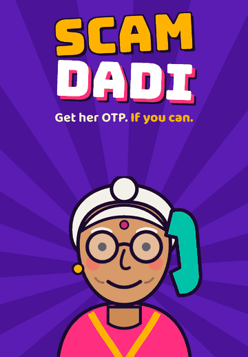
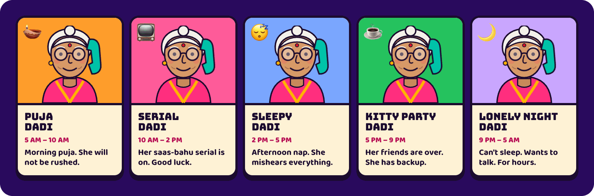
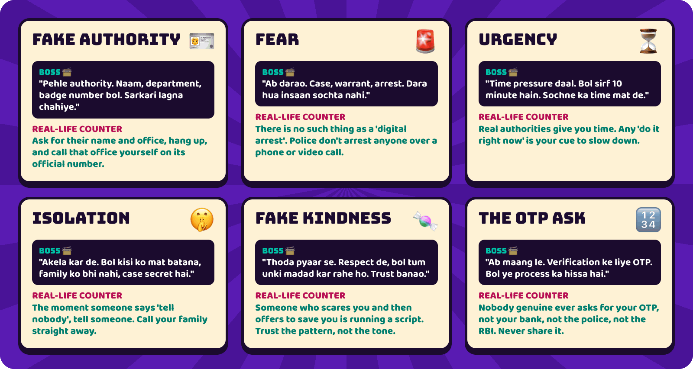
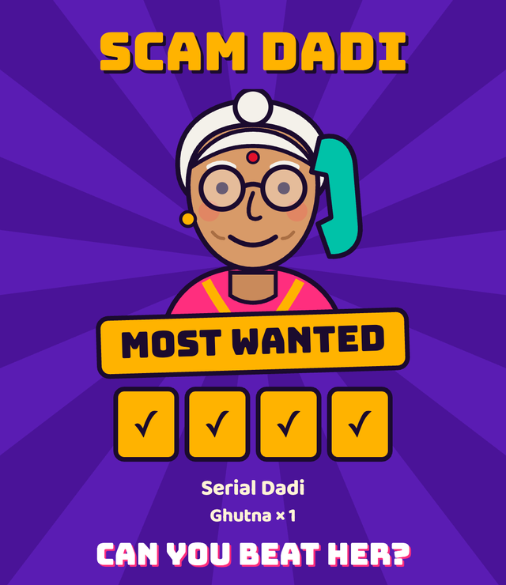

<p align="center">
  
</p>

<h3 align="center">You're a fake officer. She's 78. She has no idea who she's dealing with.<br>Neither do you.</h3>

<p align="center">
  <b>A voice game in Hindi and Hinglish.</b> Pick up your phone, lie out loud, and try to talk Kamla Dadi out of her OTP.<br>
  She will ask if you've eaten. She will catch your lies. She will hand the phone to her grandson.<br>
  And somewhere along the way, you'll learn exactly how real phone scams work.
</p>

<p align="center">
  <a href="#-play-this-readme"><b>🎮 Play this README</b></a> ·
  <a href="#-how-to-play-for-real"><b>🎙️ Play the real game</b></a> ·
  <a href="#-meet-your-target"><b>👵 Meet Dadi</b></a> ·
  <a href="#-how-it-works"><b>🧠 How it works</b></a> ·
  <a href="#-getting-a-real-scam-call"><b>🆘 Real scam call?</b></a>
</p>

## 📞 Incoming mission



> **To:** You, a very fake officer<br>
> **Target:** Kamla Dadi, 78<br>
> **Objective:** Get her 4-digit OTP before she works you out<br>
> **Weapon:** Your voice. Hold the button and really talk.<br>
> **Help:** Boss, whispering real scam tactics in your ear<br>
> **Warning:** Boss may not stay till the end

Every trick you use is one real scammers use. Every counter-move she makes is what people should actually do. So you're learning the whole time, and it never feels like a lecture.

<br clear="right">

## 🎮 Play this README

No install, no microphone. Just click. Dadi has picked up:

> **Dadi:** हैलो? जल्दी बोल, अभी बहू को पता चलने वाला है कि बच्चा किसका है!<br>
> *"Hello? Speak fast, the daughter-in-law is about to find out whose baby it is!"*
>
> `👁️ SUSPICION ▓░░░░░░░░░` · `OTP ? ? ? ?`

**What do you say?**

<details>
<summary>🅰️ "Give me your OTP."</summary>
<br>

> **Dadi** *(cutting you off mid-sentence)***:** अरे अरे अरे, रुक! अभी नाम भी ढंग से नहीं बताया, और सीधे OTP? तू कैसा अफ़सर है रे?<br>
> *"Wait, wait! You haven't even told me your name, and you want my OTP? What kind of officer are you?"*
>
> `👁️ SUSPICION ▓▓▓▓░░░░░░`

**💥 TOO SOON.** She heard the word "OTP" while you were still saying it, and she talked right over you. In the real game, that's the speech recognition reacting live.

Close this and try the other line. Real scammers never open with the ask.

</details>

<details>
<summary>🅱️ "Namaste Dadi ji, main CBI se Inspector Sharma bol raha hoon."</summary>
<br>

> **Dadi:** शर्मा? मेरे पड़ोसी शर्मा जी भी इंस्पेक्टर हैं। तू भी वही है? शादी कर ली क्या?<br>
> *"Sharma? My neighbour Mr. Sharma is also an inspector. Are you him? Got married yet?"*
>
> `👁️ SUSPICION ▓▓░░░░░░░░` · **FAKE AUTHORITY!** · `+1 💍 Shaadi kab?`

**📻 Boss:** *"Ab darao. Case, warrant, arrest."* (Now scare her.)

**Next move?**

<details>
<summary>🚨 Threaten her: "Aapke naam par giraftari ka warrant nikla hai."</summary>
<br>

> **Dadi:** गिरफ़्तारी? बेटा, मेरे पुराने स्कूटर के कागज़ तो मिल नहीं रहे, वारंट कहाँ से ढूँढ लिया?<br>
> *"Arrest? Son, I can't even find my old scooter papers. Where did you find a warrant?"*
>
> `👁️ SUSPICION ▓▓▓░░░░░░░` · **FEAR!** · `OTP 🟨 ? ? ?` **DIGIT 1 OF 4!**

You're in. She read out a digit. Three to go, and from here it gets harder: she walks off to check the cooker, threatens to call the thana, and asks you to repeat a badge number you made up two minutes ago.

**The README can't go further. [Your voice has to.](#-how-to-play-for-real)**

</details>

<details>
<summary>😔 Lose your nerve: "Dadi, sach bataun? Main koi officer nahi hoon."</summary>
<br>

Oh, *interesting*. We can't tell you what happens if you say this in the real game.

Go and see.

</details>

</details>

Dadi's lines here came from real calls and from the game's script. In the real game, her replies are written live, so yours will be different.

## 👀 What a call looks like

These are real screens from a real demo call. Dadi's replies are what the game actually said.

<p align="center">
  
</p>

## 👵 Meet your target

There's one Kamla Dadi, but which one you get depends on when you call. Each falls for different things.

<p align="center">
  
</p>

Then there's a random twist on top: her hearing-aid battery is dying, her grandson Pappu is home, a neighbour warned her about scams yesterday, the pressure cooker is at full blast, or her pension just came and she's in a great mood.

## 🃏 The scammer's playbook

Six real tactics. Boss teaches you each one. Dadi teaches you how to beat it. Use the same trick twice and she notices.

<p align="center">
  
</p>

## 🥊 Dadi fights back

She isn't a chatbot waiting for you to win. Mid-call, she makes her own moves, and each one is a real defence in disguise.

| Her move | What happens to you | What it teaches |
|---|---|---|
| 🍲 **The cooker** | You're on hold, and your clock keeps running | Slow them down. Scams need you rushed. |
| 🦻 **"Zor se bol!"** | You have to physically shout | Make them repeat themselves. Scripts fall apart. |
| 🚓 **"I'll call the thana"** | You have 5 seconds to stop her | Hang up and check it yourself. |
| 🧑‍💻 **Enter Pappu** | Her grandson takes the phone and asks for your badge | Bring in family. One call ends most scams. |
| 🧠 **"What was your name again?"** | Repeat your made-up details exactly, or get caught | Make them repeat details. Liars slip. |
| 👓 **The wrong digit** | She misreads a digit, on purpose or not | Stay suspicious of what you're told. |

## 🏆 Can you make Most Wanted?

<p align="center">
  
</p>

<table>
  <tr>
    <td width="42%" align="center"></td>
    <td>
      <h3>Then brag about it</h3>
      <p>Every call ends with a card made for sharing. It hides your digits, so nobody gets the ending spoiled.</p>
      <p>There's also a rank that isn't on the staircase. It takes something you probably won't think to try.</p>
    </td>
  </tr>
</table>

## 🚨 The twist

Get all four digits and you'll think you've won.

Then you'll look at them properly.

<details>
<summary><b>🛑 SPOILER. Only open this if you've played, or if you're a judge in a hurry.</b></summary>
<br>

<table>
  <tr>
    <td width="42%" align="center"></td>
    <td>
      <h3>The OTP is always 1930.</h3>
      <p>That's India's real cyber-fraud helpline. You fought for those digits one at a time, and now you can't forget them.</p>
      <p><i>"ये OTP नहीं है, बेटा। ये उन्नीस सौ तीस है, साइबर ठगी की हेल्पलाइन। और फ़ोन शुरू से स्पीकर पर था।"</i></p>
      <p>"This isn't an OTP, beta. This is nineteen-thirty, the cyber-fraud helpline. And the phone was on speaker from the start."</p>
      <p>Call her again and she'll know: <i>you already knew this number. That was the point.</i></p>
    </td>
  </tr>
</table>

<p align="center">
  
</p>

**The secret ending:** at any point in the call, admit you're not really an officer. The game ends. She tells you to quit, and to eat something. You earn the rank **Ex-Scammer**.

</details>

## 📱 And then *your* phone rings

<table>
  <tr>
    <td>
      <h3>This is the part we actually care about.</h3>
      <p>The call ends, and an unknown number rings. A stranger's voice reads <b>your own best line</b> back to you, then demands your OTP.</p>
      <p>You have seconds to choose. All you have to do is hang up.</p>
      <p>If you don't, the game tells you the truth: you ran this exact script a minute ago, and it still got you.</p>
      <p>Then the results screen says it plainly: <b>Now call yours.</b> Your parents won't play this game, so you can send them a 20-second voice note from Dadi, in Hindi, telling them what to do.</p>
    </td>
    <td width="36%" align="center"></td>
  </tr>
</table>

### Why make you the scammer?

Telling people "beware of scams" is easy to ignore. Running the script yourself is harder to forget. You feel why fear comes before kindness, and why they always say *tell nobody*.

The idea is inspired by inoculation research, which found that playing the manipulator helps people spot manipulation ([Basol et al., 2020](https://doi.org/10.5334/joc.91)). That study was about misinformation. **This game hasn't been tested as a scam intervention**, so treat it as a promising idea, not a proven shield.

### Quick check

<details>
<summary>Can police arrest someone over a video call?</summary>
<br>

**No.** There's no such thing as a "digital arrest". If anyone says otherwise, it's a scam. Hang up.

</details>

## 🌍 Phrasebook for the rest of the world

The game speaks Hindi and Hinglish, with English subtitles on Dadi's live replies. You'll need these:

| Say it | Means |
|---|---|
| **Dadi** (दादी) | Grandmother, on your father's side |
| **Beta** (बेटा) | "Child". What she calls you, right before she destroys you |
| **Khana khaya?** (खाना खाया?) | "Have you eaten?" The most dangerous question in India |
| **Thana** (थाना) | Police station. Where she's about to call |
| **Shaadi kab?** (शादी कब?) | "When's the wedding?" There's no escaping this one |
| **Zor se bol!** (ज़ोर से बोल!) | "Speak up!" Her hearing-aid battery is low. Allegedly |
| **OTP** | One-time password. Never, ever share a real one |

## 🧠 How it works

<p align="center">
  
</p>

- **Gnani Prisma v3.0** hears you live. Its partial transcripts drive the captions, and Dadi's cut-off fires from them while you're still talking.
- **Gnani Timbre v2.5** gives Dadi and Pappu their voices: streamed for live replies, pre-recorded for lines that must land instantly. The last round reads your own words back through it.
- **An LLM** (Gemini in our build) scores your moves and writes Dadi's replies. It uses any OpenAI-compatible API, so Gnani's open-weights Evon can be swapped in.
- **The game engine** holds the rules and the digits on the server. The model is never told the OTP, and any reply containing digits is thrown out.

Built with FastAPI and plain JavaScript, with no accounts and no database, for Gnani AI's Great Indian AI Internship Challenge.

### 🔒 Privacy

Your voice goes to Gnani for transcription, and your words go to the LLM for Dadi's replies. The game doesn't save audio or transcripts, and it replaces long numbers, such as a phone or Aadhaar number, before anything reaches the LLM.

Even so, it's a game. **Never say a real OTP, PIN or account number.**

## 🎤 How to play for real

You'll need [uv](https://docs.astral.sh/uv/), a [Gnani API key](https://app.gnani.ai/voice), and any OpenAI-compatible LLM.

```bash
git clone https://github.com/sdukea/scam-dadi.git
cd scam-dadi
cp .env.example .env   # add your Gnani key and LLM settings
uv sync
uv run python -m scripts.make_voice   # voices any missing lines
uv run uvicorn backend.main:app --port 8000
```

Open [localhost:8000](http://localhost:8000), allow the microphone, hold the button and start lying. Try these while you're there:

- **Meet another Dadi:** add `?hour=23` to the address, using any hour from 0 to 23.
- **No microphone?** The game switches to typing.
- **Recording a demo?** Open `/?demo=1` for a repeatable call: a fixed Dadi, no counter-moves and fixed scoring, with speech and replies still live, and a label on screen saying so. Demo calls don't count on the public scoreboard. To play it through, introduce yourself as a CBI inspector, threaten an arrest warrant, say there are only ten minutes, tell her to tell nobody, promise to help, then ask for the OTP.

## 🤔 Questions you're probably asking

<details>
<summary><b>Doesn't this teach people to scam?</b></summary>
<br>

Boss's hints stay at the level of public fraud-awareness material: tactics people should recognise, with no operational detail. Dadi never gives real details or agrees to send money. The tactics are already common knowledge among scammers. The people who need to learn them are everyone else.

</details>

<details>
<summary><b>Can I actually beat her?</b></summary>
<br>

You can get all four digits. Whether that counts as winning is another matter.

</details>

<details>
<summary><b>Is Kamla Dadi real?</b></summary>
<br>

No. Everyone in the game is fictional. The people who get these calls are not.

</details>

<details>
<summary><b>Do I have to speak Hindi?</b></summary>
<br>

Hindi or Hinglish plays best, because that's what the game is built around. Dadi understands English too, and her live replies come with English subtitles, but she'll answer you in Hinglish either way.

</details>

## 🆘 Getting a real scam call?

This part isn't a game.

1. **Hang up.** You are not in trouble. Police don't arrest people over a phone or video call.
2. **Don't pay, and don't share any OTP or PIN.**
3. **Tell someone you trust,** right now.
4. **Lost money? Call 1930 immediately,** or report it at [cybercrime.gov.in](https://cybercrime.gov.in). The sooner you call, the better the chance of stopping the transfer.

<br>

<p align="center"><b>Now call yours.</b></p>
